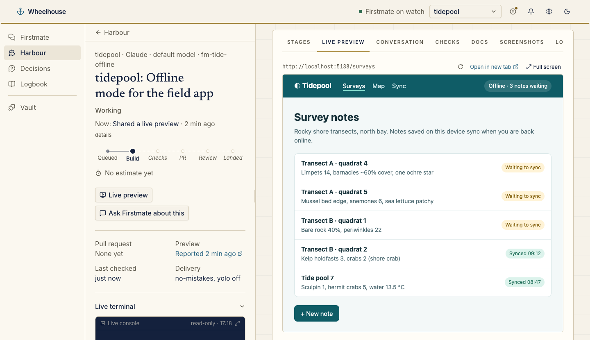
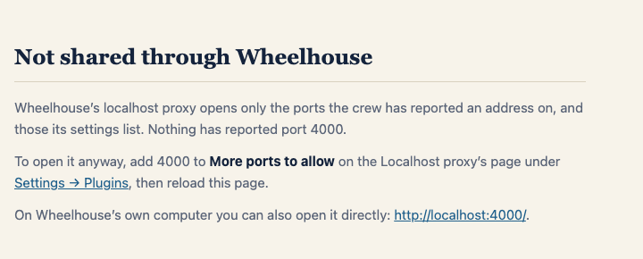
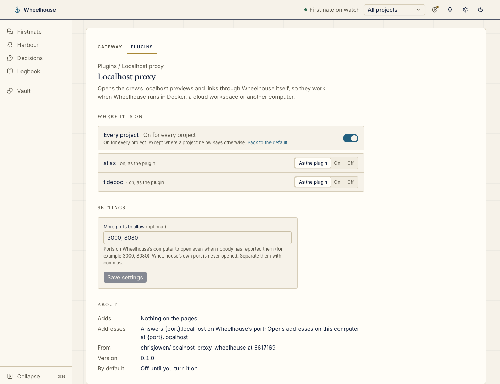

# Localhost proxy for Wheelhouse

A [Wheelhouse](https://github.com/chrisjowen/wheelhouse) plugin. When Wheelhouse runs in Docker, a cloud workspace or on another computer, the localhost addresses the crew reports (live previews, links in Firstmate's replies, status notes and decision cards) point at the viewer's own computer, where nothing answers. While this plugin is on, Wheelhouse shows each of them through itself instead: `http://localhost:5173/app` opens as `http://5173.localhost:4310/app`, where 4310 is the port you reached Wheelhouse on, and the plugin passes the request on to port 5173 on Wheelhouse's own computer. Only Wheelhouse's port needs forwarding.



```sh
wheelhouse plugin install chrisjowen/localhost-proxy-wheelhouse
```

It is off until you turn it on in **Settings → Plugins**. It needs a Wheelhouse with host routes and address rewrites (since [chrisjowen/wheelhouse#86](https://github.com/chrisjowen/wheelhouse/pull/86)), and a browser that sends `*.localhost` names to your own computer, as Chrome, Edge and Firefox do.

```
.wheelhouse-plugin/plugin.json   the manifest: off by default, its address rewrite and host route, its settings
wheelhouse/server/index.js       the host route
wheelhouse/server/proxy.js       the proxy: which ports it opens, forwarding, WebSockets, header and redirect rewrites
wheelhouse/server/addresses.js   addresses on Wheelhouse's computer, and the ports the settings allow
wheelhouse/server/hosted.js      hosted environments (Codespaces, Gitpod, the Public address setting) and a port's public address there
test/                            the tests
```

## How it works

It is built on Wheelhouse's [host routes and address rewrites](https://github.com/chrisjowen/wheelhouse/blob/main/docs/plugins.md#host-routes-and-address-rewrites). The manifest's address rewrite (`{port}.localhost`) has Wheelhouse show every http address on `127.0.0.1` or `localhost` at that name, in a live preview's frame, its **Open in new tab** and every link on its pages; the host route of the same name gets those requests, WebSockets included, and forwards them to that port on Wheelhouse's loopback (`127.0.0.1`, else `::1`), never anywhere else.

**Why a host name per port, not a path.** A proxied app gets its own origin, as on its own port: root paths such as `/assets/app.js` or `/@vite/client`, client-side routes, cookies and storage work unchanged, and Vite's hot reload WebSocket connects to the page's own host, so it reaches the app through the proxy too. A path such as `/proxy/5173/` would break every root path the app uses, and serve the app from Wheelhouse's own origin, where its scripts could read Wheelhouse's pages and session token.

**What passes through.** Requests and responses, bodies, streams and WebSockets pass through untouched, except that the app sees its own address (`Host`, and `Origin` and `Referer` from its own proxied page, become `localhost:<port>`), so a dev server that checks its host (Vite does) answers as usual; a redirect to an address on Wheelhouse's computer comes back through the proxy; and a cookie's `Domain` is dropped, so it stays with the proxied address. Absolute addresses inside a page's HTML or scripts are not rewritten.

## Which ports it opens

Only a port the crew has reported an address on since Wheelhouse started (`ctx.loopbackAddresses()`), or one **More ports to allow** lists; any other shows a page saying so, with how to allow it and a direct link for use on Wheelhouse's own computer. It never opens one of Wheelhouse's own ports (`ctx.reservedPorts()`: its server and MCP app sandboxes), even when listed.





```json
{ "plugins": { "localhost-proxy": { "enabled": true, "settings": { "ports": ["3000", "8080"] } } } }
```

## In Ona, Gitpod, Codespaces or on a remote machine

When Wheelhouse runs in a hosted dev environment, there are two ways to open it, and the plugin suits one of them.

**Through a forwarded port: the plugin works as anywhere.** Forward Wheelhouse's port to your own computer and open `http://localhost:4310`. A desktop editor connected to the environment (VS Code, Cursor, JetBrains Gateway) forwards it for you, `gh codespace ports forward 4310:4310` does for a codespace, and `ssh -L 4310:localhost:4310 <host>` does for any machine you reach over SSH, Ona and Gitpod environments included. Every preview then opens at `http://<port>.localhost:4310` through the plugin, and only Wheelhouse's port needs forwarding.

**Through the environment's public address**, such as `https://4310-abc123.ws-eu45.gitpod.io` or `https://my-codespace-4310.app.github.dev`. There, a `*.localhost` name goes to your own computer, not the environment, so `{port}.localhost` addresses cannot reach it: keep the plugin off, and open each preview at the environment's own address for its port. A plugin's address rewrite can name only a `*.localhost` host on the viewer's own port (see Wheelhouse's [host routes and address rewrites](https://github.com/chrisjowen/wheelhouse/blob/main/docs/plugins.md#host-routes-and-address-rewrites)), so showing previews at those addresses is Wheelhouse's to do, not this plugin's.

**Where a port's public address is.** The plugin works it out from the environment, or from its **Public address of a port** setting, which wins when set:

| Where Wheelhouse runs                         | Found from                                                                      | A port's public address              |
| --------------------------------------------- | ------------------------------------------------------------------------------- | ------------------------------------ |
| GitHub Codespaces                             | `CODESPACES=true`, `CODESPACE_NAME`, `GITHUB_CODESPACES_PORT_FORWARDING_DOMAIN` | `https://<name>-<port>.<domain>`     |
| Gitpod Classic                                | `GITPOD_WORKSPACE_URL`                                                          | `https://<port>-<workspace host>`    |
| Ona, a devcontainer host, a VM, anywhere else | the **Public address of a port** setting                                        | the setting, with `{port}` filled in |

The setting is an http(s) address with `{port}` once in it: in a host name (`https://{port}-myhost.example.dev`), as the port (`http://my-vm.example.dev:{port}`, for a machine whose ports are open to you) or in a path (`https://ide.example.dev/proxy/{port}/`, for an editor that serves ports under a path). An Ona environment sets no variable a port's address can be worked out from: open a port with `ona environment port open <port>`, which prints its address, and copy that address into the setting with the port number replaced by `{port}`. Ona serves only ports listened on at `0.0.0.0`.

```json
{
	"plugins": {
		"localhost-proxy": { "settings": { "publicAddress": "https://{port}-myhost.example.dev" } }
	}
}
```

Today the plugin uses a port's public address on its own pages: the page for a port it does not open links to that address instead of `http://localhost:<port>`, which only works on Wheelhouse's own computer. Its address rewrite stays `{port}.localhost` either way, and with no setting and no hosted environment found, nothing changes. Whether a public address answers you (a private Codespaces or Gitpod port wants you signed in) is the environment's to say.

## What turning it on exposes

The proxy answers on Wheelhouse's port, so whoever can reach that port can reach every port it opens, as they could from Wheelhouse's computer itself. Wheelhouse keeps its own protections in front of it: it answers only `<port>.localhost` names, which a DNS-rebinding page cannot send, and it refuses any request that changes something (anything but GET, HEAD and OPTIONS), and every WebSocket, unless it comes from the proxied page's own origin, before this plugin sees it. The plugin never takes the address to reach from the request. It adds no sign-in of its own: an app that has none is open to anyone who can reach Wheelhouse. There is no TLS, and it does not reach other hosts or open tunnels.

## Developing

There is no build step: Wheelhouse imports `wheelhouse/server/index.js` as it is, and the plugin uses only Node's own modules.

```sh
npm install
npm test        # the proxy against a real app: a page, assets, routes, a redirect, cookies, a post and a WebSocket
npm run lint    # eslint and prettier
```

`test/plugin.schema.json` is a copy of Wheelhouse's `packages/plugin-sdk/plugin.schema.json`, which the manifest test checks against.
